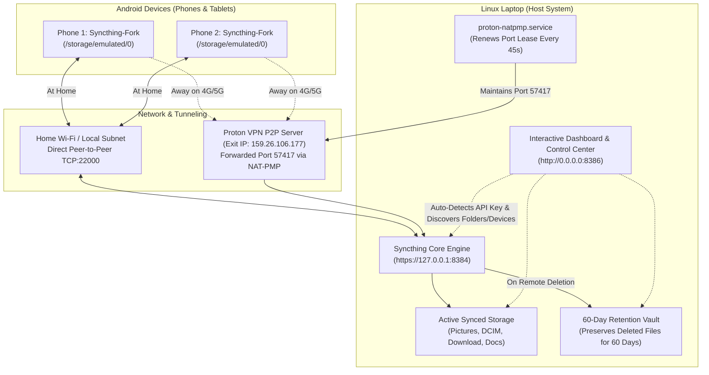

# Syncthing + Proton VPN + 60-Day Retention Hub & Dashboard
### Automated Android Backup Suite, Remote P2P Tunneling & Interactive Analytics Control Center

[](LICENSE)
[]()
[](https://syncthing.net)
[]()

Turn-key solution for syncing entire Android devices to a Linux laptop with **high-speed LAN sync**, **seamless remote sync over 4G/5G via Proton VPN Port Forwarding**, **60-day deleted file retention safety vault**, and a modern **interactive web dashboard & control center**.

---

## Architecture Overview



---

## Key Features

- **🚀 Dual-Mode Sync**:
  - **Local LAN**: Maximum Wi-Fi transfer speed at home directly between device IPs.
  - **Remote 4G/5G**: Automatically tunnels via Proton VPN Paid Port Forwarding (P2P) without exposing router ports or paying for dynamic DNS.
- **🔄 Automated NAT-PMP Lease Daemon**: Background service (`proton-natpmp.py`) automatically negotiates and renews the port lease with the VPN gateway every 45 seconds.
- **🛡️ 60-Day Deleted File Retention Vault**:
  - When files or photos are deleted from your phone, they are moved to a dedicated holding directory on your laptop (`Retention_60Days`) for **60 days** before permanent removal.
  - Retained files **never sync back to your phone** automatically.
  - **1-Click Restore**: Recover any file instantly back to active storage via the web dashboard.
- **📊 Modern Interactive Web Dashboard (`http://0.0.0.0:8386`)**:
  - **Dynamic Discovery**: Zero hardcoded IDs. Automatically detects all folders, devices, and peer statuses.
  - **Folder Sizes in GB & File Sizes in MB**: High-level folder analytics in GB (`2.06 GB`), individual files in MB (`6.83 MB`).
  - **In-Dashboard File Explorer**: Drill down through directories, inspect files, and preview photos, stream audio/video, or view PDFs in-browser.
  - **📂 Open in Linux File Manager**: 1-click button to open folders or highlight specific files directly in Nautilus / xdg-open on your laptop desktop.
  - **Interactive Charts**: Daily sync volume (MB) trends and storage distribution donut charts powered by Chart.js.
  - **⚙️ Full Control Center**: Add folders, pair devices, pause/resume sync, trigger rescans, restart the engine, and edit `.stignore` rules in a built-in code editor.
- **🔒 Zero Secrets Revealed**: Uses runtime auto-discovery from local `config.xml` and environment variables. Never stores API keys, TLS certificates, or device encryption codes in code.

---

## Quick Start (Automated 1-Click Install)

Clone the repository and run the installer on your Linux laptop:

```bash
git clone https://github.com/yb007-sketch/syncthing-proton-vault.git ~/syncthing-proton-vault
cd ~/syncthing-proton-vault
bash install.sh
```

The installer will:
1. Install `proton-natpmp.py` and `syncthing-dashboard.py` into `~/.local/bin/`.
2. Install and enable systemd user services (`proton-natpmp.service` and `syncthing-dashboard.service`).
3. Deploy the optimized Android `.stignore` template.
4. Launch the dashboard on [http://localhost:8386](http://localhost:8386).

---

## Autonomous Setup with AI Agents (Claude Code, Codex, Antigravity)

Want an AI coding agent to set up the entire stack autonomously?  
Copy the prompt in [AI_SETUP_PROMPT.md](AI_SETUP_PROMPT.md) and paste it into Claude Code, Codex, Antigravity, or Cursor.

---

## Detailed Documentation

- 📱 [Android Setup Guide](docs/ANDROID_SETUP_GUIDE.md): Syncthing-Fork setup, Scoped Storage SAF workaround, and run conditions.
- 🌐 [Proton VPN Port Forwarding Guide](docs/PROTON_VPN_SETUP.md): P2P server setup, WireGuard gateway configuration, and lease renewals.
- 💻 [Interactive Dashboard & API Reference](docs/DASHBOARD_GUIDE.md): Dashboard features, Nautilus desktop integration, and REST endpoints.
- 👥 [Multi-Device Pairing Guide](docs/MULTI_DEVICE_GUIDE.md): How to add second phones, tablets, or secondary laptops.

---

## Repository Structure

```text
syncthing-proton-vault/
├── install.sh                     # 1-Click automated installation script
├── README.md                      # Architecture, overview & setup guide
├── AI_SETUP_PROMPT.md             # One-shot autonomous prompt for AI agents
├── LICENSE                        # MIT License
├── bin/
│   ├── proton-natpmp.py           # Automated NAT-PMP port lease daemon
│   └── syncthing-dashboard.py     # Interactive Web Hub & Control Center
├── systemd/
│   ├── proton-natpmp.service      # User systemd service for VPN port lease
│   └── syncthing-dashboard.service# User systemd service for dashboard
├── config/
│   ├── stignore.template          # Battle-tested Android .stignore template
│   └── syncthing-versioning.json  # 60-day trashcan versioning configuration
└── docs/
    ├── ANDROID_SETUP_GUIDE.md     # Phone installation & permission guide
    ├── PROTON_VPN_SETUP.md        # Proton VPN port forwarding instructions
    ├── DASHBOARD_GUIDE.md         # Dashboard features & API documentation
    └── MULTI_DEVICE_GUIDE.md      # Adding multiple phones & tablets
```

---

## Service Management Commands

```bash
# Check status of the services
systemctl --user status syncthing-dashboard.service
systemctl --user status proton-natpmp.service

# Restart services
systemctl --user restart syncthing-dashboard.service
systemctl --user restart proton-natpmp.service

# Inspect live logs
journalctl --user -u syncthing-dashboard.service -f
journalctl --user -u proton-natpmp.service -f
```

---

## License

Distributed under the [MIT License](LICENSE). Created by [yb007-sketch](https://github.com/yb007-sketch).
