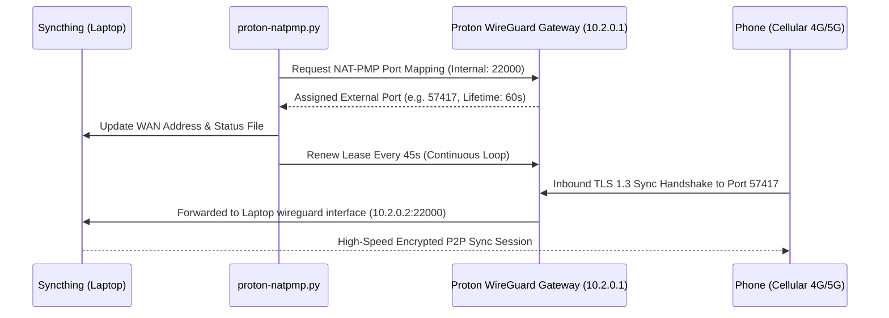

# Proton VPN Automated Port Forwarding Setup

This guide explains how remote synchronization works over the internet using **Proton VPN Paid Port Forwarding (P2P)** and the automated **NAT-PMP lease daemon**.

---

## 1. How It Works



1. **Outbound Port Forwarding**: Proton VPN assigns a dynamic external port on their exit servers (e.g. London UK, Netherlands, Switzerland, etc.).
2. **Automated NAT-PMP Lease**: WireGuard gateways require refreshing the port lease every 60 seconds. The included daemon (`proton-natpmp.py`) automatically renews the lease every 45 seconds.
3. **No Dynamic DNS Required**: Syncthing uses its global discovery network. As soon as the daemon binds the port, remote phones resolve the laptop's public IP and forwarded port automatically.

---

## 2. Proton VPN Configuration on Laptop

1. Ensure you have a **Proton VPN Plus / Unlimited** subscription (Free tier does not support port forwarding).
2. In the Proton VPN desktop client:
   - Go to **Settings > Connection**.
   - Enable **Port Forwarding**.
   - Connect to any P2P-supported server (indicated by the two-arrows icon ⇄, e.g. London, Amsterdam, Zurich).
3. The automated service (`proton-natpmp.service`) will detect the tunnel, request the port mapping, and update Syncthing automatically.

---

## 3. Verifying Active Port

Check the status file written by the daemon:
```bash
cat ~/.local/state/syncthing/proton_port.txt
```

Example output:
```text
IP=159.26.106.177
PORT=57417
UPDATED=1792851683
```

You can also view the active port and server IP live on the dashboard at `http://localhost:8386`.
